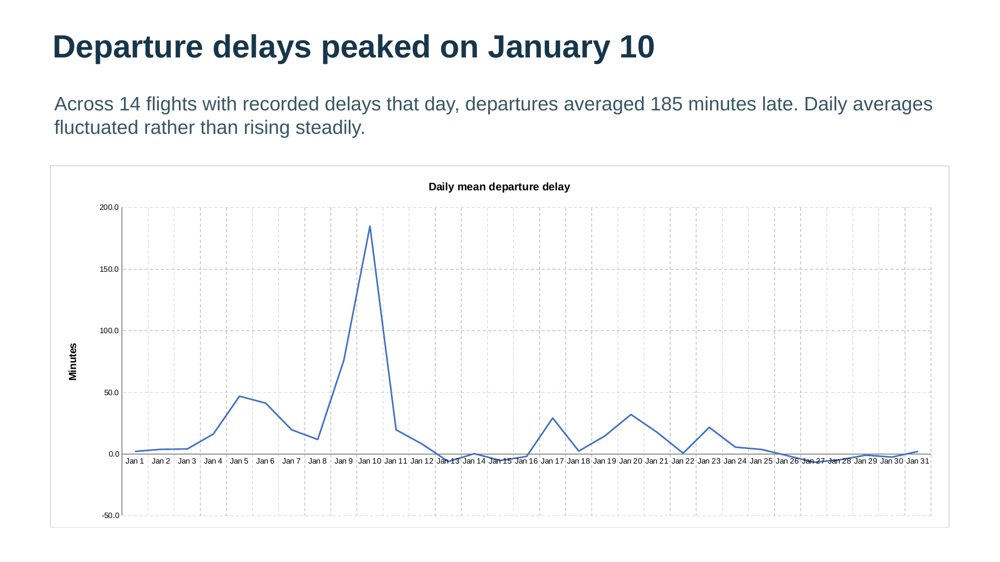
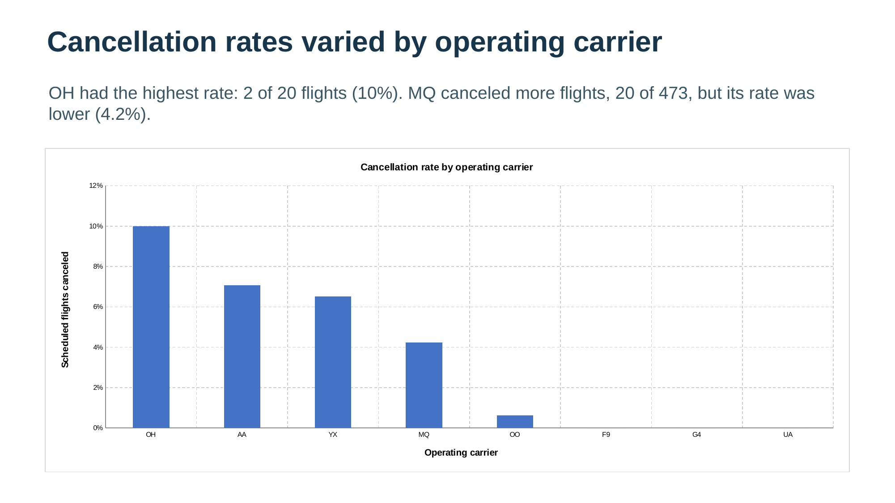
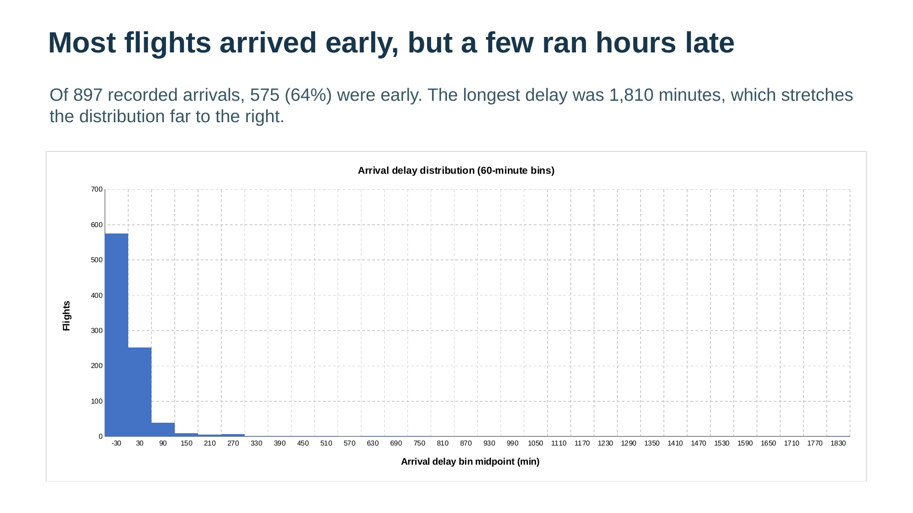
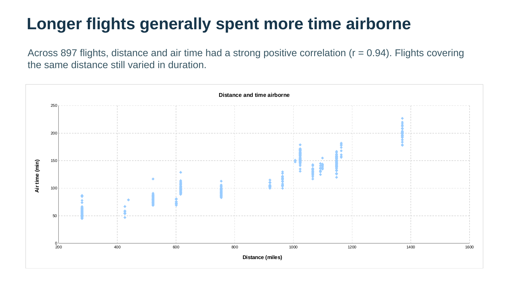

**Group members:** Reese Martin, [[Partner Name]](https://[partner-username].github.io/)

## The Data Set

For this project we used the Reporting Carrier On-Time Performance data published by the U.S. Department of Transportation's Bureau of Transportation Statistics. We pulled every flight that departed from Northwest Arkansas National Airport (XNA) in January 2025, which came out to 933 flights. Each row in the data set represents a single flight, and we kept columns for the flight date, operating carrier code, departure delay, arrival delay, cancellation status, flight distance, and actual air time.

After pasting the raw data into Excel, we renamed the columns using descriptions from the original source and used AI to help clean the data into our Flight Data sheet. Since canceled flights don't have delay or air time values, we excluded them from those calculations instead of counting them as zeros. All of our summary tables and charts live on a separate Plots sheet, with one column of work for each of our four questions.

## Question 1: How did departure delays at XNA change over the month of January 2025?

**Why it's interesting:** XNA is the nearest major airport to Fayetteville, so it's the one most students rely on to get home over breaks. January also tends to bring winter weather to the area, so we wanted to find out whether delays grew gradually throughout the month or were concentrated in sharp spikes on just a few days.

**How we used Excel:** Working from the flight date and departure delay columns, we grouped the 898 recorded departure delays on the Plots sheet by date and calculated an average delay for each day of the month. Some of the values were negative, meaning those flights actually left early, so we kept that in mind when reading the results. The daily averages made one day stand out: on January 10, 14 flights departed an average of 185 minutes late.

**How we developed the visual:** Since this question is about how something changes over time, we chose a line chart with the date on the horizontal axis and the average daily delay in minutes on the vertical axis. We used a single line color, labeled both axes with their units, and made sure zero stayed visible on the axis so days with early departures fall clearly below it.

## Question 2: Which operating carriers canceled the largest share of their XNA flights?

**Why it's interesting:** The airline we book with matters when we're trying to get home, and a cancellation causes far more trouble than a delay. We wanted to know whether some carriers at XNA canceled flights more often than others, and whether the carrier with the most cancellations was actually the least reliable one.

**How we used Excel:** Using the operating carrier and canceled columns, the Plots sheet counts each carrier's scheduled departures and cancellations, then divides cancellations by scheduled departures to find a cancellation rate. Across all 933 departures, the scheduled flights by carrier were OH 20, AA 99, YX 92, MQ 473, OO 162, F9 4, G4 52, and UA 31. Looking at rates rather than raw counts changed the story: MQ had the most cancellations at 20, but that was only a 4.2% rate, while OH canceled just 2 flights yet had the highest rate at 10%.

**How we developed the visual:** Comparing a single value across categories is a natural fit for a bar chart. We ordered the carriers from highest to lowest cancellation rate, formatted the vertical axis as percentages, and labeled both axes. The headline states our claim, and the supporting text gives the counts behind the two most important bars. Because we only had one month of data, we were careful not to suggest that the carrier itself caused the difference.

## Question 3: How are arrival delays for flights leaving XNA distributed?

**Why it's interesting:** An average doesn't always reflect what a typical trip is like, so we wanted to see whether most flights out of XNA actually arrive on time and how often a flight ends up extremely late. This matters a lot for anyone with a connection to catch or a ride waiting at the destination.

**How we used Excel:** We sorted the recorded arrival delays into 60-minute bins and counted how many flights landed in each one. Flights without arrival delay data were left out, and we kept the largest delays in so the chart would show the full range. Of the 897 recorded arrivals, 575 arrived early, while the longest delay reached a staggering 1,810 minutes.

**How we developed the visual:** A histogram is the best way to show the distribution of a single numerical variable, which is something we picked up in our statistics class. We removed the gaps between the bars so the bins touch, labeled each bin by its midpoint, and labeled the vertical axis as the number of flights. The main takeaway is the long right tail: most flights arrived early, but a handful ran many hours behind.

## Question 4: How is a flight's distance related to the time it spends in the air?

**Why it's interesting:** XNA serves both nearby and faraway cities at all times of day. We expected longer flights to spend more time in the air, but we wanted to measure how strong that relationship really is and how much flight times vary among flights covering the same distance.

**How we used Excel:** On the Plots sheet, we paired distance in miles with air time in minutes for the 897 flights that had both values. From those pairs we calculated the Pearson correlation coefficient and got r = 0.94, which indicates a strong positive relationship.

**How we developed the visual:** Comparing two numerical variables calls for a scatter plot, so we put distance on the horizontal axis and air time on the vertical axis, each labeled with its units. Every marker represents one flight, so flights on the same route stack into vertical clusters, which makes it easy to see how much air time varies at a fixed distance. We included the correlation coefficient in the supporting text so the number backs up the claim in our headline.
